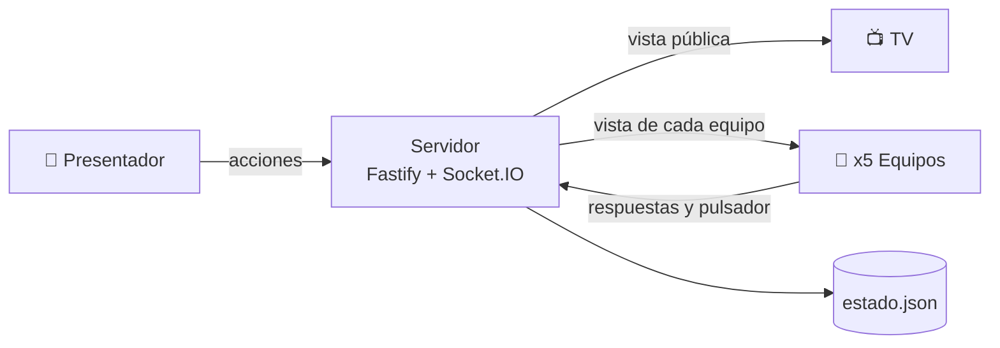

# Concurso del Cumple

[](LICENSE)


**Un concurso de televisión para un cumpleaños en casa.** La TV hace de plató, el presentador lo dirige todo desde su móvil y cada uno de los 5 equipos juega con el suyo. No hay que instalar nada: se entra escaneando un QR.

## Qué hace

| | |
|---|---|
| 🎯 **7 tipos de prueba** | Test, adivinar (lista o rosco), precio justo, canciones (MP3 o Spotify), palabra prohibida o dibujo, pruebas físicas con cronómetro y el Kahoot del cumpleañero. |
| 🏆 **Puntuación de concurso** | Cada prueba reparte 10/5/3/1 por puestos. En el test, 1 punto por acierto con plus por rapidez. |
| ⚡ **Pulsador justo** | Compensa la latencia de cada móvil: gana quien pulsa antes, no quien tiene mejor wifi. |
| ↩️ **Sin miedo a equivocarse** | Deshacer en directo, corrección de puntos antes de confirmar y una partida que sobrevive a reinicios y cortes de red. |
| 🎭 **Votación de disfraces** | Con revelación del podio y desempate. |

## Cómo funciona



El servidor es la única fuente de verdad: guarda la partida y envía a cada pantalla solo lo que le toca ver. Así ningún equipo ve las respuestas de los demás antes de tiempo. Detalle en [arquitectura](docs/arquitectura.md) y [flujos](docs/flujos.md).

| Pieza | Tecnología |
|---|---|
| Servidor | Node 22, Fastify 5, Socket.IO 4 |
| Pantallas | React 19 + Vite (TV, presentador, equipos, admin y votación) |
| Datos | JSON en disco con escritura atómica |
| Música | MP3 propios o Spotify Web Playback SDK |
| Tests | vitest (puntuación, escenarios de partida) y Playwright en Chrome y Safari de iPhone |

## Empezar

```sh
pnpm install
pnpm dev          # servidor en :3000 + Vite en :5173 (PIN 1234)
```

| Comando | Qué hace |
|---|---|
| `pnpm test` | Tests de puntuación y de la partida |
| `pnpm build && pnpm e2e` | e2e en Chrome y Safari (`--project=chromium` o `--project=safari`) |
| `node tools/deploy.mjs X.Y.Z` | Despliegue (ver [operaciones](docs/operaciones.md)) |

## Estructura

```
server/     index.ts (Fastify + Socket.IO), juego.ts (máquina de estados), spotify.ts, validar.ts
shared/     tipos.ts (contrato), puntuacion.ts, revision.ts
src/pages/  Tv, Presentador, Jugar (equipos), Admin, Votar
tests/      unitarios · e2e/ Playwright · tools/ lanzador de la TV y despliegue
```

## Documentación

Índice completo en [docs/](docs/README.md).

| Para… | Lee |
|---|---|
| Presentar el concurso | [Guía del día](docs/guia-del-dia.md) |
| Entender qué hace | [Requisitos](docs/requisitos.md) · [Flujos](docs/flujos.md) |
| Entender cómo está hecho | [Arquitectura](docs/arquitectura.md) |
| Desplegar y configurar Spotify | [Operaciones](docs/operaciones.md) |

## Licencia

[MIT](LICENSE) © 2026 José Luis García Valverde
