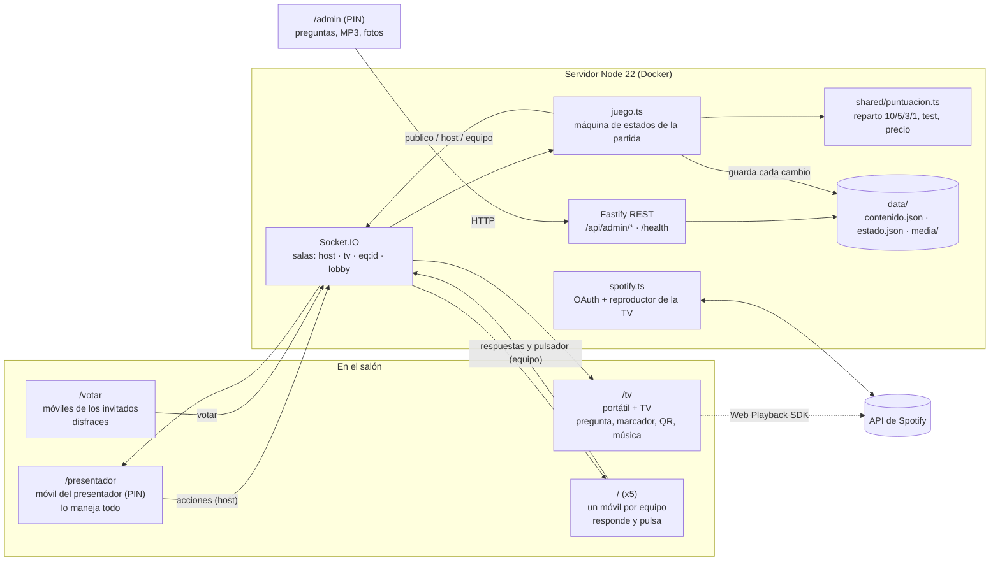
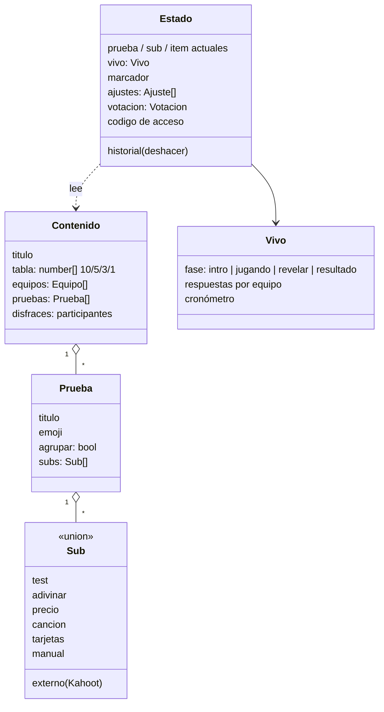
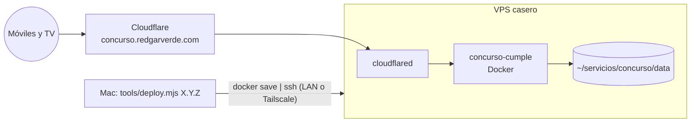

# Arquitectura

[← Documentación](README.md) · [README del proyecto](../README.md)

Una sola app de Node que sirve cuatro pantallas y las mantiene sincronizadas en tiempo real con Socket.IO. El servidor tiene la única fuente de verdad (la partida) y cada pantalla recibe solo la vista que le toca.

## Pantallas y servidor

| Pieza | Archivo | Qué hace |
|---|---|---|
| Servidor | `server/index.ts` | Fastify (REST, estáticos y subidas) y Socket.IO. Autentica al presentador por PIN y guarda el estado en disco con escritura atómica (archivo temporal + `rename`). |
| Partida | `server/juego.ts` | La máquina de estados: pruebas, turnos, cronómetros, respuestas, revisión, deshacer y votación. Genera las vistas `Publico`, `VistaHost` y `VistaEquipo`. |
| Puntuación | `shared/puntuacion.ts` | Reparto por puestos con empates, test con plus por rapidez, precio justo «sin pasarse» y compensación de latencia del pulsador. |
| Tipos | `shared/tipos.ts` | El contrato entre servidor y pantallas. |
| Validación | `server/validar.ts` | Comprueba el contenido que llega desde `/admin`. |
| Spotify | `server/spotify.ts` | OAuth con la cuenta Premium y control del reproductor que corre en la TV. |

## Modelo de la partida

El contenido (`contenido.json`) es lo que se prepara antes. El estado (`estado.json`) es la partida en curso: si el servidor se reinicia, todo sigue donde estaba.

## Despliegue

## Decisiones

| Decisión | Por qué |
|---|---|
| Servidor con autoridad y vistas por rol | Ningún equipo ve las respuestas ajenas antes de tiempo, y la TV nunca enseña lo que solo debe ver el presentador. |
| Socket.IO | Reconexión automática y salas por rol. Los móviles con mala wifi vuelven solos. |
| JSON en disco en lugar de base de datos | Es una partida de una noche: dos archivos, legibles y fáciles de restaurar. |
| Pulsador con compensación de latencia (máx. 150 ms) | Gana quien pulsa antes de verdad, no quien tiene mejor red. El tope evita trampas retrasando los pings. |
| Deshacer en el presentador | Un error en directo se arregla con un toque, sin reiniciar nada. |
