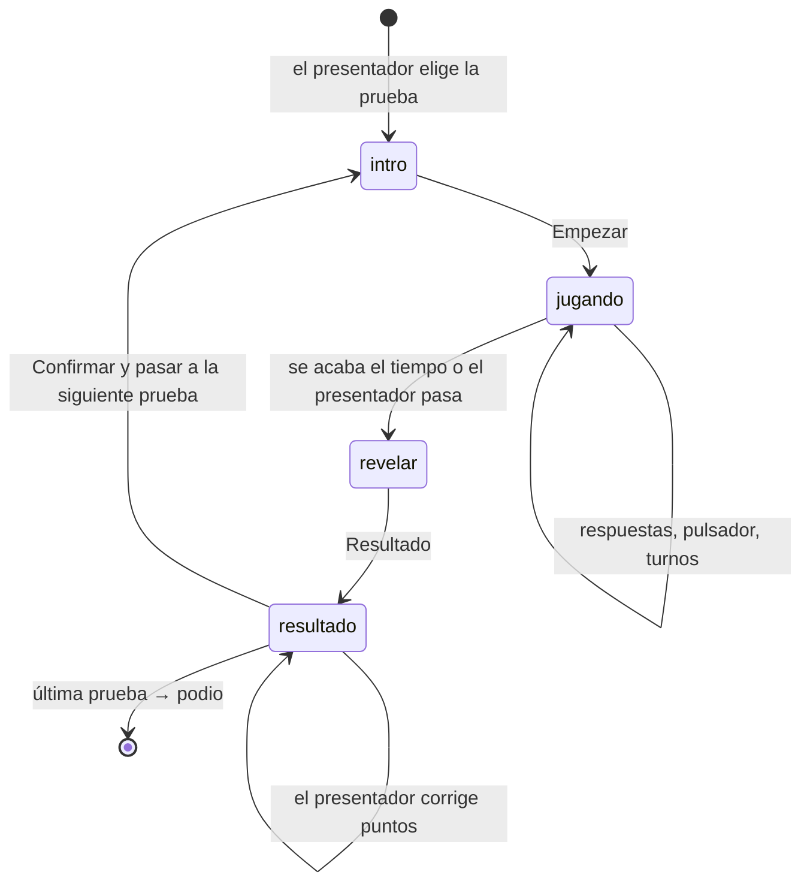
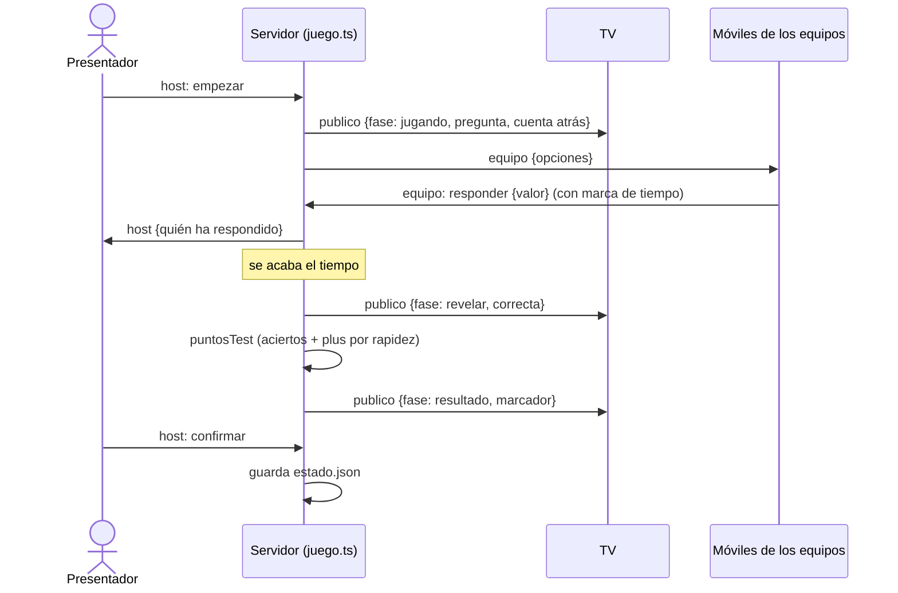
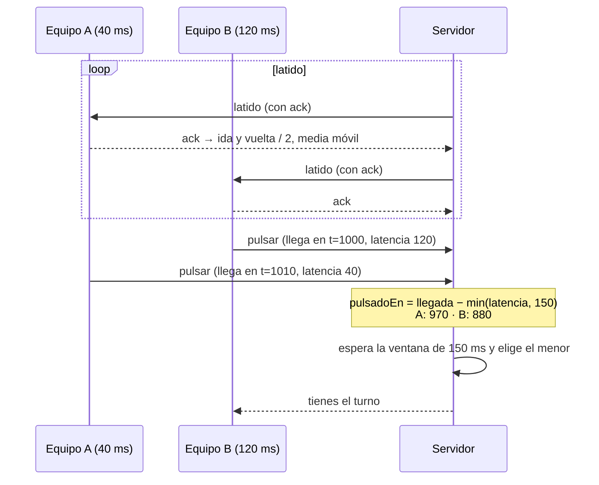
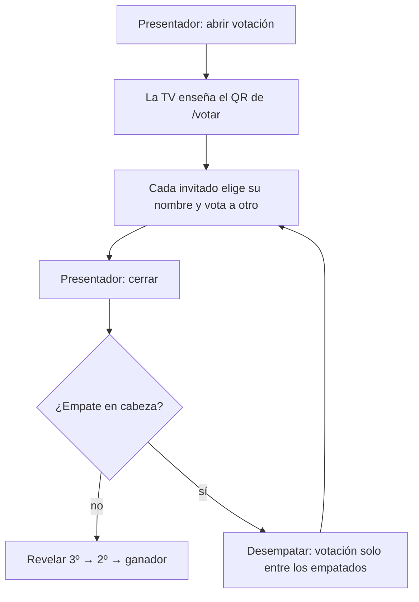
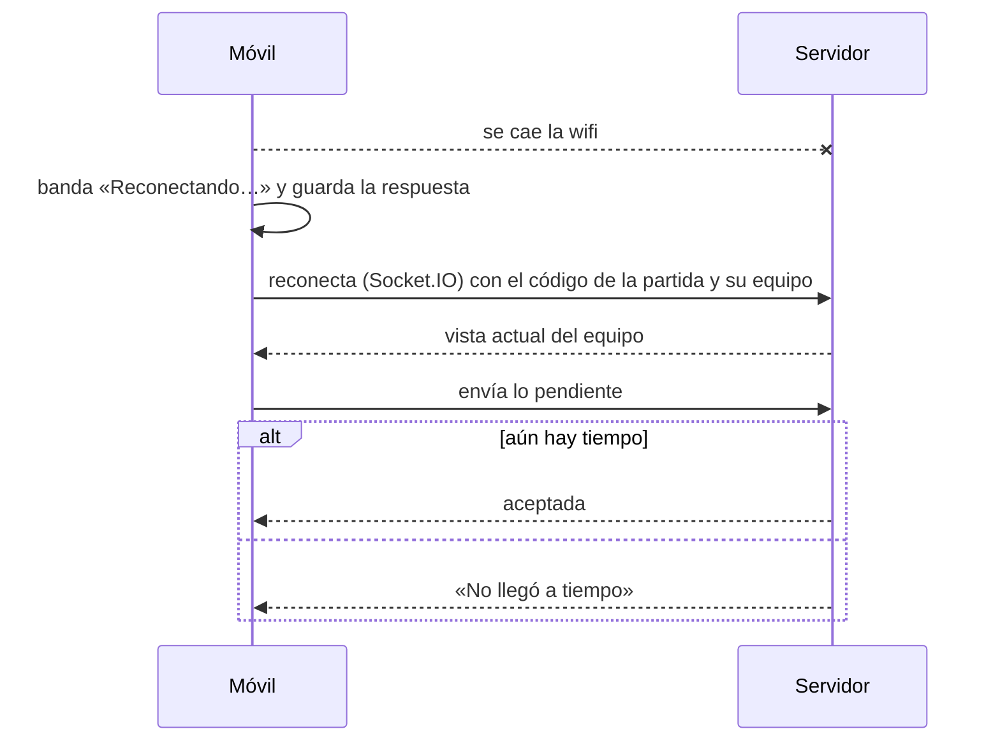

# Flujos principales

[← Documentación](README.md) · [README del proyecto](../README.md)

## Ciclo de una prueba

## Una pregunta tipo test

## Pulsador justo

## Votación de disfraces

## Reconexión

